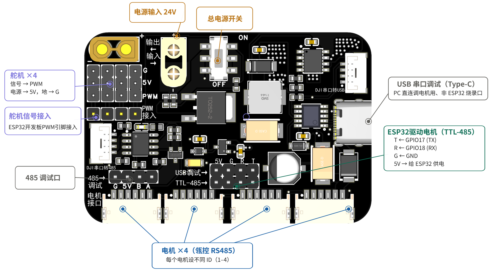

# 08 MG4010-i10 RS485 电机使用指南

> 本指南面向零基础学习者，目标是先安全接线，再理解厂家 RS485 协议，最后完成串口和网页控制。

---

## 1. 电机和协议版本

本课程使用的是 **MG4010-i10 RS485 版本电机**。厂家资料包含两类信息：

- [MG4010-i10电机手册.pdf](../硬件资料/技术文档/MG4010-i10电机手册.pdf)：电机供电、接口、减速比、上位机设置等。
- [MG4010-i10-R485协议.pdf](../硬件资料/技术文档/MG4010-i10-R485协议.pdf)：RS485 通信帧格式和控制命令。

需要特别注意：厂家 RS485 协议 **不是 Modbus-RTU 寄存器协议**。本课程示例代码使用厂家私有帧协议，帧头为 `0x3E`，通过命令字控制电机。

主要参数：

```text
供电电压：7.4V~32V，首次测试建议使用 24V
通信接口：RS485
默认波特率：115200
数据格式：8 数据位，无校验，1 停止位（8N1）
默认 ID：1
ID 范围：1~32
减速比：i10，即电机侧转 10 圈，输出轴约转 1 圈
编码器分辨率：18bit（手册标称）
```

---

## 2. 接线方法

### 2.1 电机接口

以厂家手册中的 RS485 接口定义为准：

| 电机接口 | 含义 |
|---------|------|
| V+ | 电源正极 |
| V- | 电源负极 |
| A/H | RS485-A |
| B/L | RS485-B |

部分配套线材可能用颜色区分。接线前以实际线材说明或万用表确认，不要只凭颜色判断。

### 2.2 推荐接线：使用 RS485/供电转接板

课程配套转接板原理图见：

[转接板原理图.pdf](../硬件资料/技术文档/转接板原理图.pdf)

上机接线示意图见：



建议学生优先使用这块转接板，而不是直接用散装 RS485 模块。转接板把 RS485 通信、电机电源输入、电机 A/B 总线和公共地集中到一块板上，能显著减少初学者接错电源或忘记共地的概率。

按转接板丝印核对下列连接：

| ESP32-S3 | 转接板 | 说明 |
|----------|--------|------|
| 5V | USB调试 5V | ESP32 可从 USB 调试口给转接板 5V 供电 |
| GND | USB调试 G | 与电机电源负极共地 |
| GPIO17 (TX) | TTL-485 调试 T | ESP32 UART 发送到转接板，TX 接 T |
| GPIO18 (RX) | TTL-485 调试 R | 转接板回传数据到 ESP32 UART，RX 接 R |

| 电机电源/电机 | 转接板 | 说明 |
|---------------|--------|------|
| 24V 电源正极 | 输入端子上孔 | 输入端子有防呆，上正下负 |
| 24V 电源负极 | 输入端子下孔 | 与 ESP32 GND 共地 |
| MG4010 B/L | 电机 6pin 的 B | 从板子正面看、接口在下方时，第 1 pin |
| MG4010 A/H | 电机 6pin 的 A | 从板子正面看、接口在下方时，第 2 pin |
| MG4010 V- | 电机 6pin 的 GND/GND | 从板子正面看、接口在下方时，第 3、4 pin |
| MG4010 V+ | 电机 6pin 的 24V/24V | 从板子正面看、接口在下方时，第 5、6 pin |

四个并排的电机 6pin 接口定义相同。从板子正面看、接口在下方时，每个 6pin 从左到右为：

```text
B    A    GND    GND    24V    24V
```

从原理图看，课程配套转接板的 RS485 芯片 `DI` 接 `TX3`，`RO` 接 `RX3`，`RE#` 和 `SHDN#` 已经通过 10k 上拉到 `5VIN`，收发方向由转接板处理。ESP32 不需要再接 GPIO16 控制 DE/RE。

上电前重点检查 `24VIN/VIN` 和 `GND` 不要接反，`A/B` 不要和电源端子混接。转接板上的 `5VIN`、`VCC` 等网络按实际板子丝印和课堂配套线使用，不要把它们当作电机 24V 输入。

### 2.3 替代接线：使用通用 RS485 模块

本教程示例默认使用如下引脚：

| ESP32-S3 | RS485 模块 | 说明 |
|----------|------------|------|
| GPIO17 | DI | ESP32 发送到 RS485 模块 |
| GPIO18 | RO | RS485 模块发送到 ESP32 |
| GPIO16 | DE 和 RE | 收发方向控制，两个引脚连在一起 |
| 3.3V | VCC | 优先使用 3.3V 兼容 RS485 模块 |
| GND | GND | 必须与电机电源负极共地 |
| RS485-A | A/H | 接电机 A/H |
| RS485-B | B/L | 接电机 B/L |

GPIO17、GPIO18、GPIO16 已在本教程使用的 ESP32 开发板排针上引出。使用课程配套转接板时只用 GPIO17/GPIO18；使用通用 RS485 模块时才额外使用 GPIO16 控制 DE/RE。这样避开了 UART0 调试/下载使用的 GPIO43/GPIO44，也避开了原生 USB 使用的 GPIO19/GPIO20 和启动配置相关引脚。

推荐使用支持 3.3V 逻辑的 SP3485、MAX3485 或明确标注 3.3V 可用的 RS485 模块。若使用 5V MAX485 模块，要确认 RO 输出不会把 5V 直接送入 ESP32 GPIO。

### 2.4 供电要求

```text
电机供电：独立 12V~24V 电源，首次测试建议 24V 2A 以上
ESP32 供电：USB 或稳定 5V
共地要求：ESP32 GND、RS485/供电转接板或 RS485 模块 GND、电机电源 V- 必须连接
```

不要用 ESP32 的 5V 或 3.3V 引脚给电机供电。电机启动电流较大，供电不足会导致电机抖动、ESP32 复位或通信异常。

---

## 3. 厂家 RS485 帧格式

单电机命令的基本格式：

```text
帧头     命令字   电机 ID   数据长度   帧命令校验   数据区   数据校验
0x3E     CMD      0x01      N          SUM          ...      SUM
```

校验规则：

- 帧命令校验：`帧头 + 命令字 + ID + 数据长度`，只保留低 8 位。
- 数据校验：数据区所有字节相加，只保留低 8 位。
- 多字节整数使用小端序，即低字节在前。

示例：让 ID 为 1 的电机进入运行状态。

```text
3E 88 01 00 C7
```

计算方式：

```text
0x3E + 0x88 + 0x01 + 0x00 = 0xC7
```

---

## 4. 常用命令

| 功能 | 命令字 | 数据长度 | 说明 |
|------|--------|----------|------|
| 电机关闭 | `0x80` | 0 | 关闭输出，电机仍可回复命令 |
| 电机停止 | `0x81` | 0 | 停止运动，不清除运行状态 |
| 电机使能 / 运行状态 | `0x88` | 0 | 从关闭状态切换到可控制状态；不会单独产生转动 |
| 读取多圈角度 | `0x92` | 0 | 返回 `int64_t`，单位 0.01° |
| 清除错误 | `0x9B` | 0 | 错误原因解除后才能清除 |
| 读取状态 2 | `0x9C` | 0 | 返回温度、电流采样、速度、编码器 |
| 速度闭环 | `0xA2` | 4 | `int32_t speedControl`，单位 0.01dps |
| 多圈位置闭环 2 | `0xA4` | 12 | `int64_t angleControl` + `uint32_t maxSpeed` |
| 设置零点到 ROM | `0x19` | 0 | 写入 Flash，不要频繁使用 |

学习时建议先掌握 `0x88`、`0x81`、`0x9C`、`0xA2` 和 `0xA4`。

> [!IMPORTANT]
> `0x88` 只是“使能/进入运行状态”，不是“给速度”。如果只发送 `0x88`，电机通常不会转动。想让输出轴真正转起来，需要再发送速度闭环命令 `0xA2`，也就是运行 `06_电机速度模式`。

---

## 5. 电机 ID 设置

本教程单电机例程默认使用 `MOTOR_ID = 1`。最终两电机整合时，两个电机必须使用不同 ID，建议：

```text
左电机：ID 1
右电机：ID 2
```

如果两个电机 ID 相同，它们会同时响应同一条命令；读取状态时还可能同时回包，导致 RS485 总线冲突。

### 5.1 如何确认或修改 ID

MG4010-i10 的 ID 通常通过厂家上位机或电机上的拨码设置，具体方法以随电机提供的手册为准。本仓库已提供手册：

[硬件资料/技术文档/MG4010-i10电机手册.pdf](../硬件资料/技术文档/MG4010-i10电机手册.pdf)

建议按下面顺序操作：

1. 先只接一个电机，不要把两个电机同时接到 RS485 总线上。
2. 使用厂家上位机或按手册说明检查当前电机 ID。
3. 将第一台电机设为 ID 1，贴上“左电机 / ID1”标签。
4. 断电后换接第二台电机，将它设为 ID 2，贴上“右电机 / ID2”标签。
5. 分别用 `05_电机基础控制` 修改 `MOTOR_ID` 后测试 `s` 读状态，确认两个 ID 都能单独通信。
6. 两台电机都确认后，再接入最终整合例程。

如果电机版本带拨码开关，应按电机手册中的拨码表设置 ID。拨码设置完成后通常需要断电重启电机才会生效。不要在两个电机 ID 未确认前直接接入最终整合工程。

---

## 6. 减速比和单位换算

MG4010-i10 的减速比为 1:10。厂家协议里的速度和角度是 **电机侧** 数值，而你实际观察到的是 **输出轴**。

### 6.1 速度换算

学生在串口和网页中输入的速度统一使用 **RPM**，也就是“每分钟转多少圈”。厂家协议内部使用 `dps`，表示“每秒转多少度”。两者关系如下：

```text
1 RPM = 1 圈/分钟 = 360°/60 秒 = 6 dps
```

协议速度单位为 `0.01dps/LSB`。MG4010-i10 减速比为 1:10，因此程序内部会做下面的换算：

```text
输出轴 dps = 输出轴 RPM × 6
电机侧速度 dps = 输出轴 dps × 10
协议原始值 = 电机侧速度 dps × 100
```

示例：希望输出轴以 10 RPM 转动。

```text
输出轴速度 = 10 RPM = 60dps
电机侧速度 = 60 × 10 = 600dps
协议原始值 = 600 × 100 = 60000
```

学生操作时只需要记住 RPM。dps 是为了理解厂家协议和代码中的换算。

### 6.2 位置换算

协议位置单位为 `0.01°/LSB`，多圈位置命令使用电机侧角度。

```text
电机侧角度 = 输出轴角度 × 10
协议原始值 = 电机侧角度 × 100
```

示例：希望输出轴转到 90°。

```text
电机侧角度 = 90 × 10 = 900°
协议原始值 = 900 × 100 = 90000
```

---

## 7. 示例代码学习顺序

| 示例 | 内容 | 学习重点 |
|------|------|----------|
| 05_电机基础控制 | 使能、停止、关闭、清错、读状态、读角度 | 帧格式、校验、收发方向；不负责连续转动 |
| 06_电机速度模式 | 速度闭环控制 | RPM 输入、减速比和协议换算 |
| 07_电机位置模式 | 多圈位置闭环控制 | 位置单位、速度限制 |
| 08_电机网页控制 | Wi-Fi AP 网页控制 | 网页交互与非阻塞轮询 |
| 09_机器人整合控制 | 两个 RS485 电机和四个 PWM 舵机 | 总线 ID、多设备调度 |

`05_电机基础控制` 用来确认通信，输入 `r` 后只是让电机进入可控制状态；如果学生预期看到输出轴转动，应继续打开 `06_电机速度模式`。

第一次真正让电机转动时不要直接高速运行。**注意单位：速度模式输入的是 RPM（每分钟转数），不是 dps（度每秒）**。例如：
- 输入 `5` 表示输出轴 5 RPM，适合首次空载测试
- 输入 `10` 表示输出轴 10 RPM，适合确认正反转
- 输入 `30` 表示输出轴 30 RPM（约等于 180 dps）
- 输入 `60` 表示输出轴 60 RPM（约等于 360 dps）

位置模式先测试 `30`、`60`、`90` 这类小角度。

最终工程如果需要两个 MG4010-i10 电机，不需要给每个电机单独占用一组 UART。两个电机可以共用同一条 RS485 A/B 总线，但必须提前设置为不同 ID，例如左电机 ID 1、右电机 ID 2。程序发送命令时把 ID 放入协议帧，两个电机按 ID 分别执行。

最终机器人工程请参考：

- `教程文档/09_robot_integration.md`
- `示例代码/09_机器人整合控制/09_robot_integrated_control.ino`

---

## 8. 常见问题

### 8.1 电机没有任何回复

按顺序排查：

1. 电机是否有独立电源，电压是否在允许范围内。
2. ESP32 GND、RS485/供电转接板或 RS485 模块 GND、电机 V- 是否共地。
3. RS485 A/B 是否接反。
4. 电机 ID 是否与代码中的 `MOTOR_ID` 一致。单电机基础例程默认 ID 为 1。
5. 电机波特率是否为 115200。
6. 使用转接板时，GPIO17(TX) 是否接 TTL-485 调试口 T，GPIO18(RX) 是否接 R，ESP32 5V/GND 是否接 USB调试 5V/G，24V 输入是否上正下负。
7. 使用通用 RS485 模块时，DE/RE 是否接到 GPIO16，模块是否支持 ESP32 的 3.3V 逻辑。

### 8.2 串口能发送，但电机不动

可能原因：

- 你正在运行 `05_电机基础控制`。这个例程只验证通信，`r` 只是发送使能命令 `0x88`，不会给速度目标。
- 电机处于关闭状态，需要先发送 `0x88` 使能命令。
- 电机存在保护错误，需要先排除故障，再发送 `0x9B` 清除错误。
- 速度或位置目标过小，看起来像没有动作。
- 机械负载过大，电机进入保护或堵转。

如果 `05_电机基础控制` 的 `s` 能读到状态，但 `r` 后电机不转，这是正常现象。继续运行 `06_电机速度模式`，从 `5` 或 `10` RPM 开始测试。

### 8.3 电机方向和预期相反

厂家手册中方向与电机安装方向、上位机设置有关。初学阶段先接受“正负号控制两个方向”的概念，不要急着修改驱动内部方向参数。若项目需要统一方向，可在代码里对速度和角度乘以 `-1`。

### 8.4 设置零点要谨慎

`0x19` 会把当前位置作为零点写入驱动器 Flash。Flash 有擦写寿命，不要把它当作普通控制命令反复调用。练习时优先使用读取角度和相对目标，不建议频繁写 ROM 零点。

---

## 9. 学习建议

### 9.1 学习路线

| 阶段 | 内容 | 完成标志 |
|------|------|----------|
| 安全接线 | 电源、共地、A/B 接线、断电检查 | 上电前能独立检查接线 |
| 协议认识 | `0x3E` 帧、命令字、校验和 | 能说出一帧命令由哪些字段组成 |
| 基础控制 | 运行、停止、读取状态 | 能用串口读到状态，理解“运行状态”不等于“转动” |
| 速度模式 | RPM、减速比、正反转 | 能设置低速正转和反转 |
| 位置模式 | 角度单位、多圈位置、速度限制 | 能让输出轴转到指定小角度 |
| 网页控制 | AP 模式、HTTP 参数、状态刷新 | 能用浏览器控制电机 |

### 9.2 必须掌握的检查步骤

1. 上电前先检查电源正负极，确认没有短路。
2. 先打开串口监视器，再给电机供电。
3. 第一次发送命令先读状态，不要直接高速运行。
4. 速度从小到大增加，观察电机和电源是否异常。
5. 出现异常声音、发热、复位或失控时立即断电。

### 9.3 课程目标

完成本章后，你应能够：

1. 说清楚 RS485 和 UART 的区别。
2. 根据厂家协议组装一帧控制命令。
3. 理解校验和的作用。
4. 解释减速比对速度和角度的影响。
5. 使用串口和网页两种方式控制电机。

---

## 10. 参考资料

- [硬件资料/技术文档/MG4010-i10电机手册.pdf](../硬件资料/技术文档/MG4010-i10电机手册.pdf)
- [硬件资料/技术文档/MG4010-i10-R485协议.pdf](../硬件资料/技术文档/MG4010-i10-R485协议.pdf)
- 示例代码：`示例代码/05_电机基础控制` 到 `示例代码/08_电机网页控制`
